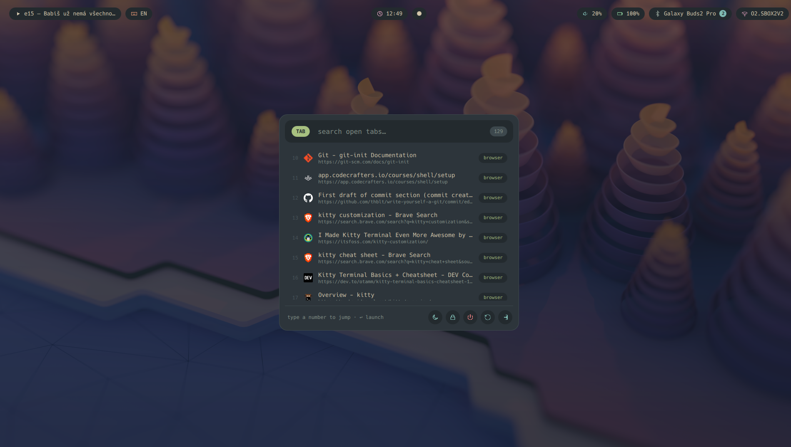
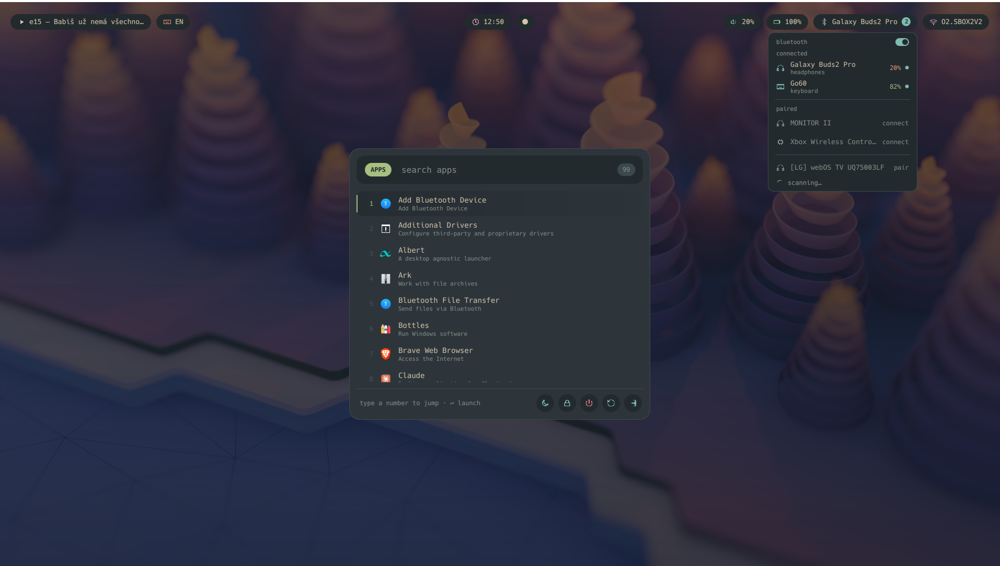

# AppLauncher

A full-screen, keyboard-first launcher and command palette for **KDE Plasma on
Wayland**, built with [Quickshell](https://quickshell.org). One text box is both
a fuzzy search field and a command line: launch apps, jump to an existing
window, switch browser or terminal tabs, open Obsidian notes, run a Google
search, or trigger power actions — all from a single overlay. A top bar adds
live clock, workspaces, keyboard layout, volume, battery, Bluetooth, Wi-Fi/VPN
and media controls.

---

## How it looks







---

## What it connects to

The launcher itself is pure QML. Everything beyond launching `.desktop` apps is
done by small helper scripts (`*.sh`) that shell out to the tools below. Each
integration degrades gracefully: if a tool is missing, that scope simply shows
an empty-state hint instead of breaking.

| Feature | Connects via | Notes |
|---|---|---|
| **Terminal tabs** (`term`) | **[kitty](https://sw.kovidgoyal.net/kitty/)** remote control | Lists and focuses kitty tabs over its unix socket (`/tmp/kitty-<pid>`). |
| **Browser tabs** (`tab`) | **tabctl** CLI + browser extension | `tabctl list` / `tabctl activate` drive the browser via a native-messaging host. |
| **Notes** (`note`) | **[Obsidian](https://obsidian.md)** | Reads the vault from `obsidian.json`, opens notes through the `obsidian://` URI. |
| **Web search** (`google`) | default browser | Opens `https://www.google.com/search?q=…` via `xdg-open`. |
| **Open windows** (`open`) / app raise | **KWin** scripting | Finds and activates windows via `qdbus6` + KWin scripts (Wayland can't focus-steal otherwise). |
| **Power** (`power`) | `systemctl`, `loginctl`, KDE `LogoutPrompt` | Sleep / Lock / Shut Down / Restart / Log Out. |
| **Top bar** | Quickshell services + scripts | Pipewire (volume), UPower (battery), Bluetooth, Mpris (media); keyboard layout + workspaces via `gdbus`; Wi-Fi/VPN via `nmcli`. |

---

## Prerequisites

### Environment
- **KDE Plasma on Wayland** (uses KWin scripting and several `org.kde.*` D-Bus
  services — it will not work on other compositors as-is). _This is Kubuntu's
  default session._
- **[Quickshell](https://quickshell.org)** with Qt 6 (`QtQuick`, `QtQuick.Layouts`,
  `QtQuick.Shapes`). Provides the `qs` / `quickshell` binary. _Not in the Ubuntu
  repos — follow the [official install guide](https://quickshell.org/docs/)._

### Command-line tools

- `bash` — _ships with Kubuntu._
- `jq` — **not shipped with Kubuntu; install it.**
- `qdbus6` — KWin scripting (window raising / listing). _Ships with Kubuntu (Plasma 6)._
- `gdbus` — keyboard layout + virtual desktops. _Ships with Kubuntu._
- `nmcli` (NetworkManager) — Wi-Fi / VPN pill. _Ships with Kubuntu._
- `journalctl` — reads KWin script output. _Ships with Kubuntu (systemd)._
- `xdg-open`, `xdg-settings` — open notes / search, resolve default browser. _Ships with Kubuntu._
- `setsid` (util-linux) — _ships with Kubuntu._
- `spectacle` — the built-in "Print Screen" action. _Ships with Kubuntu._

On Kubuntu, `jq` is the only command-line tool that is usually missing. To install
every tool above in one go (already-present ones are skipped):

```bash
sudo apt install jq qdbus-qt6 libglib2.0-bin network-manager xdg-utils util-linux kde-spectacle
```

### Optional integrations
Each is only needed for its scope:

- **kitty** — for the `term` scope. _Not shipped with Kubuntu:_
  ```bash
  sudo apt install kitty
  ```
  Then enable remote control in `~/.config/kitty/kitty.conf`:
  ```conf
  allow_remote_control yes
  listen_on unix:/tmp/kitty
  ```
  kitty appends `-<pid>` to the socket, giving `/tmp/kitty-<pid>` (one per instance).
  Restart kitty after changing this.

- **tabctl** — for the `tab` scope. Install the `tabctl` CLI **and** its browser
  extension, then register the native-messaging host so that `tabctl list`
  returns your open tabs:
  ```bash
  pipx install tabctl   # or: pip install --user tabctl
  tabctl install        # registers the native-messaging host
  ```
  _Not in the Ubuntu repos; install the matching browser extension from your
  browser's add-on store._

- **Obsidian** — for the `note` scope. _Not in the Ubuntu repos — install the
  Flatpak (recommended) or the official `.deb`:_
  ```bash
  flatpak install flathub md.obsidian.Obsidian
  ```
  Either the native or the Flatpak install works; the vault is auto-detected from
  Obsidian's `obsidian.json`.

---

## Install

```bash
git clone <this-repo> AppLauncher
cd AppLauncher
chmod +x *.sh        # ensure the helper scripts are executable
```

No build step — Quickshell interprets the QML directly. The scripts are resolved
relative to `shell.qml`, so keep all files together in one directory.

---

## Usage

**1. Register the config.** Quickshell discovers configs by name under
`~/.config/quickshell/<name>/shell.qml`. Symlink this repo in as `launcher`:

```bash
ln -s /path/to/AppLauncher ~/.config/quickshell/launcher
```

**2. Run it:**

```bash
qs -c launcher
# or by path:  qs -p /path/to/AppLauncher/shell.qml
```

**3. Bind a hotkey.** In **System Settings → Shortcuts → Custom Shortcuts**, add
a command shortcut (e.g. `Meta+Space`) that runs `qs -c launcher`. Each press
launches a fresh instance; the launcher closes itself after you act or press
`Esc`.

### Scopes

Type `:` to open the command palette and pick a scope, or type a scope keyword
directly. Available scopes:

| Scope | What it searches |
|---|---|
| _(default)_ | Installed applications (plus matching power actions and a Google fallback). |
| `tab` | Browser + kitty tabs. |
| `term` | kitty terminal tabs only. |
| `open` | Currently open windows (raise the exact one). |
| `new` | Launch a fresh app instance (skip raising an existing window). |
| `note` | Obsidian notes. |
| `google` | Google web search for the query. |
| `power` | Sleep / Lock / Shut Down / Restart / Log Out. |

**Keys:** `↑`/`↓` to move (wraps around), `Enter` to act, `Esc` to close. A
query that is _only a number_ (e.g. `3`) selects that row by position in any
scope.

---

## Project layout

- `shell.qml` — the controller: state, filtering, launch/raise/activate logic.
- `*.qml` — UI components and singletons (`Theme`, `Icons`, `PowerActions`, the
  top-bar pills, result rows, input capsule). See [`DESIGN.md`](DESIGN.md).
- `*.sh` — the integration helpers (`list-tabs.sh`, `list-notes.sh`,
  `activate-tab.sh`, `app-raise.sh`, `raise-window.sh`, `list-windows.sh`,
  `topinfo.sh`, `netinfo.sh`).
- `mockups/` — standalone HTML design references.
- `DESIGN.md` — the full design system.
